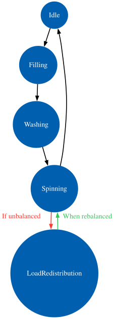

[](https://github.com/mdjkenna/GraphStateMachines/actions/workflows/buildAndTest.yml)
[](https://codecov.io/gh/mdjkenna/GraphStateMachines)
[](https://central.sonatype.com/artifact/io.github.mdjkenna/graph-state-machines)


[](https://github.com/mdjkenna/GraphStateMachines)

# GraphStateMachines

State machines often start simple. 

They can quickly become difficult to design and maintain with conditional branching, loops, and dynamic behaviour depending on runtime conditions. 

In a procedural design, that complexity tends to accumulate as fragile control flow and scattered logic.

This library: `GraphStateMachines` addresses these challenges by treating a state machine as a directed graph. 

States are modelled as vertices. Transitions are modelled as explicit directed edges. Using this approach, a state machine is designed by constructing a graph of relationships between states. 

Being declaratively designed with an explicitly stated set of possible transitions - these state machines are easy to understand, test, maintain and visualise. 

The graph is defined declaratively using a Kotlin domain specific language (DSL).

This approach offers several advantages:

*   **Validation:** Invalid transitions are implicitly prevented by the absence of an edge in the graph.
*   **Declarative State Modelling:** The Kotlin DSL avoids complex procedural code that can be difficult to maintain.
*   **Visualization and Communication:** Generate DOT language representations of state machines to visualise and verify possible state transitions.
*   **Flexibility:** The library's features offer flexible ways to structure state machines and customise their behaviour.
*   **Focus:** A focused implementation that does not add transitive dependencies to your project.

Two kinds of state machine can be constructed in the library: A `Traverser` and a `Walker`.
They are described in detail in the documentation site along with their available features.

## Installation

Add Maven Central and then add the package as a dependency. 

Replace `<version>` with the latest version.

```kotlin
repositories {
    mavenCentral()
}

dependencies {
    implementation("io.github.mdjkenna:graph-state-machines:<version>")
}
```

## Quick Start

This section demonstrates the definition and usage of a graph state machine.

### 1. Defining States

A state is an implementation of the `IVertex<I>` interface. 

A state instance has an `id` property of type `I` which is unique within the graph. 

They are added to a state machine in a DSL builder as vertices in a graph. 

They are easy to implement, with examples below:

```kotlin
data class Vertex(override val id: String) : IVertex<String>

val A = Vertex("A")
val B = Vertex("B")
val C = Vertex("C")
val D = Vertex("D")
```

### 2. State machine examples

Traversers implement standard depth-first search (DFS) which naturally includes backtracking,
meaning they backtrack through ancestor vertices to find unentered paths.

Walkers just perform a greedy transition through the next available edge i.e. a graph walk.

The difference is made clear in this example.

The graph in the example has a dead end at `B`. Both machines take `A -> B` first. 

After that:
- **Traverser:** Continues to `C` via backtracking.
- **Walker:** does not backtrack and stays at `B`

```kotlin
val graph = buildPlainGraph {
    addVertex(A) {
        addEdge {
            setTo(B)
        }
        
        addEdge {
            setTo(C)
        }
    }
    
    addVertex(B)
    
    addVertex(C) {
        addEdge {
            setTo(D)
        }
    }
    
    addVertex(D)
}

val traverser = buildTraverser<Vertex, String> {
    setWorkflowGraph(
        startAtVertex = A,
        graph = graph
    )
}

val walker = buildWalker<Vertex, String> {
    setWorkflowGraph(
        startAtVertex = A,
        graph = graph
    )
}

repeat(3) {
    traverser.dispatch(GraphStateMachineAction.Next)
}

repeat(3) { 
    walker.dispatch(GraphStateMachineAction.Next)
}
```

**Why does the traverser behave differently to the walker?**

The traverser uses Depth First Search (DFS). There are many resources online describing this type of graph traversal.
The walker uses a greedy search, simply exploring the next available edge that it finds.

**Why did the Walker stop ? Do these state machines just stop when they have nowhere else to go ?**

Yes they just stop. The graph above has a definite beginning and ending. 
Graphs such as this are common with workflows for example, or any situation you prefer to model with a definite "finished" status.
A traverser would stop at `D`.

You can design graphs without a definite ending using cycles.
The state machine can be designed to transition indefinitely through any number of cycles at your discretion.

Referencing the documentation site or KDoc comments in the code will make this clearer.

### 3. Graph Visualisation

The state machines in the library can be visualised easily. 
A `DotGenerator` utility is provided which converts a state machine into a plain string Dot representation, 
a universal graph representation language that many tools understand. 

Tools such as Graphviz can use this Dot string representation to output a PNG or SVG of the state machine's underlying graph. 
There are options online that let you paste in the Dot string and generate a PNG or SVG image.

State machine visualisation can serve multiple purposes:

- **Documentation:** Generate accurate diagrams directly from executable code, eliminating the risk of documentation drift.
- **Debugging:** Visualise the complete state structure to identify missing transitions, unreachable states, or unintended cycles.
- **Communication:** Share visual representations with team members to verify design intent and discuss state flow behaviour.
- **Verification:** Confirm that the implemented graph matches the intended design before deployment.

Below is an example of state machine visualisation based on a simple model of a washing machine.

The simplified model of a washing machine is: 
- Initially it is idle
- When it is activated it first needs to fill with water
- After filling with water it washes contents with detergent
- The detergent needs to then be rinsed off with rapid spinning
- When it is finished it becomes idle again 
- If an unbalanced load is detected during spin, the machine enters a redistribution loop before attempting to spin again.

In the code snippet a `Walker` implements this washing machine model.

```kotlin
val idle = Vertex("Idle")
val filling = Vertex("Filling")
val washing = Vertex("Washing")
val spinning = Vertex("Spinning")
val loadRedistribution = Vertex("LoadRedistribution")

data class WashingMachineContext(
    @field:Volatile
    var isUnbalanced: Boolean = false
) : MachineContext {
    override fun onReset() {
        isUnbalanced = false
    }

    fun onUnbalancedEvent() {
        isUnbalanced = true
    }

    fun onBalancedEvent() {
        isUnbalanced = false
    }
}

        val walker = buildWalkerWithContext<Vertex, String, WashingMachineContext>(
    machineContext = WashingMachineContext(
        isUnbalanced = false
    )
) {
    buildGraph(idle) {
        v(idle) {
            e {
                setTo(filling)
            }
        }

        v(filling) {
            e {
                setTo(washing)
            }
        }

        v(washing) {
            e {
                setTo(spinning)
            }
        }

        v(spinning) {
            e {
                setTo(loadRedistribution)
                onBeforeTransition {
                    if (machineContext?.isUnbalanced != true) blockTransition()
                }
            }

            e {
                setTo(idle)
            }
        }

        v(loadRedistribution) {
            e {
                setTo(spinning)
                onBeforeTransition {
                    if (machineContext?.isUnbalanced != false) blockTransition()
                }
            }
        }
    }
}

val dotGraph = DotGenerator.generateDotFromMachine(walker)
println(dotGraph)
```

Note you will have to imagine that something external is driving the state changes by dispatching actions, 
this component is omitted for brevity.

The above example prints the Dot language representation of the `Walker`. 
In addition, the appearance of generated diagrams can be customised through configuration and decoration. 
The customisation in the below snippet is used in the rendered image.

```kotlin
val customizedDot = DotGenerator.generateDotFromMachine(walker) {
    decorateEdge(
        fromId = "Spinning",
        toId = "LoadRedistribution",
        decoration = EdgeDecoration(
            description = "If unbalanced",
            color = "#FF3B30",
            fontColor = "#FF3B30"
        )
    )
    
    decorateEdge(
        fromId = "LoadRedistribution",
        toId = "Spinning",
        decoration = EdgeDecoration(
            description = "When rebalanced",
            color = "#34C759",
            fontColor = "#34C759"
        )
    )
}
```



## 4. Additional Features

-   **Configurable traversal through the graph model:** Different strategies for transitioning through the graph structure are available.
-   **- Supports transitioning to previous states: Maintain full path history to enable bidirectional transitions through entered states.
-   **Cycles and conditional transitions through the graph are fully supported:** Graphs can contain cycles and transition hooks can be used to dynamically control transitioning through cyclic paths.
-   **Effects are supported within the state model itself:** Intermediate states allow side effects to be represented as explicit vertices within the graph.
-   **Action arguments can be dispatched to a state machine allowing for conditional transition decisions:** Actions support custom arguments accessible to transition hooks and entry/exit hooks for dynamic, context-aware transitions.
-   **Predictable and atomic state transitions via a single-threaded actor model:** State machines process actions sequentially on a coroutine scope with a single-threaded dispatcher. Optionally bring your own scope to integrate the state machine with your own structured concurrency needs such as application lifecycle.

## Documentation

For detailed guides and API documentation, visit the [Documentation Site](https://mdjkenna.github.io/GraphStateMachines/).
There are also detailed KDoc comments provided with the library code that most IDEs will be able to retrieve. 
